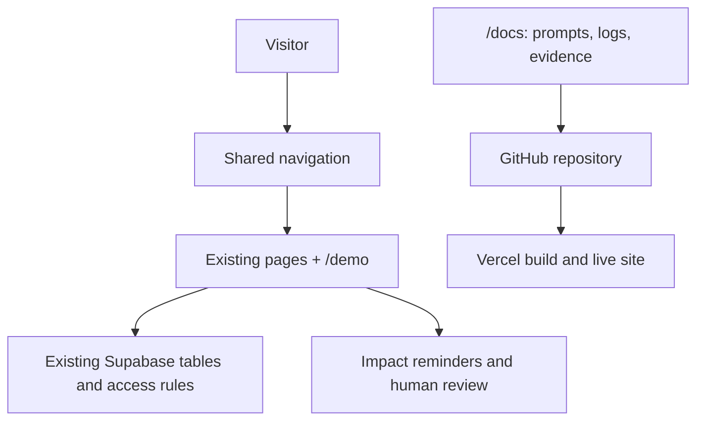

# CakeMatch AI — Week 6 Build Discipline Packet
## Integrated Agentic Venture + Impact & Viability

**Student:** Camila Gutiérrez Porter Ballesteros  
**Project:** CakeMatch AI  
**Required live route:** `/demo`  
**Planning status:** Prepared before Week 6 application-code changes. User testing, deployment, and final evidence are not yet complete.

## 1. Problem

People planning a celebration need a simple way to turn their event details into cake ideas that fit their preferences and budget. The CakeMatch team also needs one place to review the project’s existing research, product and pricing plans, marketing work, and design assistant. The final demo should show how the pieces fit together and make the limits of the suggestions clear.

## 2. User

The main user is a person planning a birthday or another celebration who wants help choosing a cake. A second user is an independent bakery, which is a future customer segment. Bakery management, orders, and payments are not part of this week’s build.

## 3. Success

Week 6 is successful when:

- The public `/demo` page loads and guides a visitor through the integrated CakeMatch experience.
- Existing Week 0–5 features remain reachable and working.
- `/dashboard` shows real records available from the existing Supabase tables, with empty, loading, and error states. It never presents sample records as real user data.
- `/docs` provides the prompt library and build logs, including Week 6 evidence.
- An agent map explains the current product flow without implying that separate autonomous agents or paid AI services are running.
- The impact check reminds visitors to confirm allergies, ingredients, feasibility, and pricing with a bakery. It does not guarantee safety.
- Five external users test the integrated site, a full-site regression check is recorded, issues are corrected, and affected checks are repeated.
- The final evidence packet includes the live URL, GitHub link, five coding prompts, at least five meaningful commits, at least two deployments, test and iteration evidence, a five-minute demo video, and a 150–250-word human decision note.

## 4. UX Concept and scope cut

The mockup is `docs/WEEK6_DEMO_MOCKUP.jpg`. It shows navigation, a three-step guided demo, event details, a clearly labeled sample suggestion, an agent map, an impact check, and saved results.

The mockup is a planning concept. During implementation, adapt its layout to the existing CakeMatch visual identity (cream background, blush accents, burgundy actions, and current typography). It is not evidence that a feature already works.

This week will not add paid APIs, payments, checkout, bakery order management, real-time inventory, guaranteed allergy-safe recommendations, autonomous actions, or new account features. Simulated or rule-based output will be labeled clearly. Existing project features and data remain the source of truth.

## 5. Product specification and acceptance criteria

### Integration and navigation

- Add consistent navigation linking Home, Core, Research, Product, Pricing, Marketing, Chat, Dashboard, Docs, and Demo.
- Preserve the existing route names and working behavior.
- `/demo` loads directly and contains a short guided walkthrough with links or actions that lead through the existing venture pages.

### Demo, agent map, and impact check

- The walkthrough explains the user problem, how the current CakeMatch features fit together, and what the visitor can try.
- The agent map identifies the current modules and their inputs/outputs. It labels rule-based or simulated results honestly and does not claim live autonomous agents.
- The impact check addresses allergy/ingredient verification, budget limits, and human confirmation. It uses plain language and makes no safety or price guarantee.
- A Version 2 roadmap distinguishes future ideas from features that exist now.

### Dashboard and docs

- `/dashboard` reads only from existing configured tables and their current access policies. It shows available record types and recent records, with empty, loading, and error states.
- No fabricated records, private keys, or environment values appear in the UI or repository.
- `/docs` includes the Week 6 macro-prompt, actual build prompts, build log, test summary, iteration log, and links to the planning mockup and packet.

### Testing and evidence

- Five external people test the integrated experience using fictional event details. Record anonymized task outcomes and feedback only with permission; do not invent results.
- Run the existing automated tests, lint, build, and a full-site route regression check. Check responsive layout and keyboard navigation.
- Record observed issues, corrections, and retest results. Do not mark planned tests or deployments as complete before they happen.

## 6. Architecture

The browser renders the Next.js App Router pages. Existing pages keep their current logic. The dashboard reads only the already configured Supabase records that the browser is permitted to access. GitHub stores source and evidence; Vercel builds and hosts the site. Do not add or loosen database policies as part of integration.

## 7. Tech stack

| Tool | Use this week |
|---|---|
| Next.js App Router, React, TypeScript | Shared navigation, `/dashboard`, `/demo`, and integrated routes |
| Existing Tailwind CSS | Responsive styling consistent with CakeMatch |
| Existing Supabase client | Read existing records under existing policies |
| Node test runner, ESLint, Next build | Automated and regression checks |
| GitHub | Source history, planning, prompts, test and iteration evidence |
| Vercel | Preview and production hosting |

Use the project’s installed versions and existing libraries. No paid services or new external AI API are needed.

## 8. DevOps plan

1. Keep this packet and mockup committed before application-code edits.
2. Review current Git status, existing Week 0–5 pages, schema/setup files, and project-specific Next.js instructions.
3. Build in small, separately committed steps. Keep at least five meaningful commits with the packet/mockup first and implementation/fixes later.
4. Record at least five actual coding-agent prompts in the Week 6 prompt log; do not invent prompt history.
5. Deploy at least twice and verify the live `/demo` route after the final deployment. Record actual deployment URLs and results.
6. Do not expose `.env.local`, Supabase service-role keys, or other secrets in GitHub, screenshots, or the submission packet.

## 9. Test plan

- Run `npm test`, `npm run lint`, and `npm run build`.
- Visit every existing and new route: `/`, `/core`, `/research`, `/product`, `/pricing`, `/marketing`, `/chat`, `/dashboard`, `/docs`, and `/demo`.
- Verify dashboard loading, empty, populated, and error states against actual configured data access. Do not seed fake records to make the page look populated.
- Check the guided demo and navigation at desktop and mobile widths, keyboard access, visible focus, and basic screen-reader labels.
- Conduct five external user sessions on the integrated experience using fictional scenarios. Record what each participant could complete, where they hesitated, and one useful improvement. Do not collect sensitive personal or allergy details.
- Fix issues found and repeat the affected tests. Preserve evidence of actual results in `docs/WEEK6_TEST_LOG.md`.

## 10. Required implementation prompt

> ROLE: You are my disciplined AI-native product architect and coding partner. COURSE RULE: Do not let me code before the plan is clear. TASK: Integrate CakeMatch AI for Week 6 using `docs/WEEK6_BUILD_DISCIPLINE.md` and `docs/WEEK6_DEMO_MOCKUP.jpg`. First inspect the existing Week 0–5 pages, database client and table access, project instructions, styles, and Git status. Then add consistent navigation, `/dashboard` for real accessible records, `/docs` with the Week 6 prompt library/build logs, and a guided `/demo` walkthrough. Add an honest agent map, practical impact reminders, testing summary, and a Version 2 roadmap. Preserve existing features and data policies. Clearly label simulated results. Do not create fake user records, claim allergy safety, add paid APIs, or imply autonomous agents are running. Use the existing Next.js/React, Tailwind, Vercel, GitHub, and Supabase setup. Keep changes small and testable, make at least five meaningful commits, document at least five actual prompts, complete five external user tests and a full-site regression check, fix and retest issues, and verify at least two deployments. Do not claim any test, user session, commit, or deployment is complete without evidence.

## 11. Human decision note (complete after testing)

Write 150–250 words after implementation and user testing. Explain what was built, which proposed features were cut and why, what user feedback changed, what risks or limits remain, and what should wait for Version 2. Use real observations from the five test sessions. Do not fill this section with guessed outcomes.

## Implementation prompt log

### Prompt 1 — Shared navigation

> Add one shared CakeMatch AI navigation in the root layout linking Home, Plan, Research, Product, Pricing, Marketing, Design chat, Dashboard, Docs, and Demo. Remove duplicate page-level navigation so each route has one consistent navigation. Preserve all routes and the existing visual style. Check the Next.js 16 local documentation before changing the App Router layout.

### Prompt 2 — Demo and project dashboard

> Build the Week 6 `/demo` route as a guided walkthrough of existing CakeMatch pages, with an honest map of current modules, a practical allergy/budget/human-review impact check, and a clearly future-only Version 2 roadmap. Add `/dashboard` to show real event-plan, research, and pricing records from existing Supabase tables under current policies. Include loading, empty, and unavailable states. Never seed fake data or show private chat/marketing records. Follow the Week 6 packet and existing CakeMatch styles.
